# Jarkom-Modul-4-2026-K-25

## Anggota
| Nama | NRP | 
|---|---|
| Muhammad Yusuf | 5027251067 |
| Azhari Rahma Putri | 5027251114 |

## Laporan CPT-VLSM

## 1.1 Pendahuluan

Pada praktikum ini dilakukan perancangan jaringan komputer menggunakan metode subnetting Variable Length Subnet Mask (VLSM). Metode VLSM digunakan untuk membagi satu blok alamat IP menjadi beberapa subnet dengan ukuran yang berbeda sesuai kebutuhan jumlah host pada setiap jaringan.

Perancangan jaringan dilakukan berdasarkan topologi yang telah ditentukan dalam soal praktikum. Setiap node memiliki kebutuhan host yang berbeda sehingga diperlukan pembagian alamat IP yang efisien agar penggunaan alamat tidak berlebihan.

Blok alamat IP yang digunakan dalam praktikum ini adalah **10.76.0.0/19**. Pembagian subnet dilakukan berdasarkan jumlah host pada setiap node dan kebutuhan alamat IP untuk koneksi antarrouter.

## 1.2 Tujuan Praktikum

1. Memahami konsep subnetting menggunakan metode VLSM.
2. Menghitung kebutuhan alamat IP berdasarkan jumlah host pada setiap jaringan.
3. Membagi satu blok jaringan menjadi beberapa subnet dengan prefix yang berbeda.
4. Menentukan network address, subnet mask, rentang IP host, dan broadcast address.
5. Menyusun perencanaan pengalamatan IP sebagai dasar pembuatan topologi dan konfigurasi perangkat jaringan.

## 1.3 Informasi Jaringan

Blok alamat IP yang diberikan untuk praktikum adalah:

| Keterangan | Nilai |
|---|---|
| Network awal | 10.76.0.0 |
| Prefix awal | /19 |
| Subnet mask | 255.255.224.0 |
| Total alamat IP | 8.192 |
| Alamat IP yang dapat digunakan | 8.190 |
| Rentang alamat | 10.76.0.0 – 10.76.31.255 |

Blok jaringan /19 memiliki kapasitas 8.192 alamat IP. Alamat tersebut kemudian dibagi menjadi beberapa subnet sesuai kebutuhan host pada topologi.

## 1.4 Identifikasi Kebutuhan Host

Sebelum melakukan perhitungan VLSM, terlebih dahulu dilakukan identifikasi kebutuhan host pada setiap node. Kebutuhan host mencakup perangkat akhir dan interface router yang berada dalam subnet tersebut.

Berikut merupakan kebutuhan host berdasarkan topologi praktikum:

| Subnet | Koneksi/Jaringan | Kebutuhan Host |
|---|---|---:|
| A1 | Cyberia – Switch1 – JJ dan MyuMyu | 126 |
| A2 | Cyberia – Wired | 2 |
| A3 | Wired – Switch2 – Psyche, Copland, Schumann | 4 |
| A4 | Psyche – Switch3 – Karl dan Lin | 881 |
| A5 | Copland – Switch4 – Masayuki | 301 |
| A6 | Copland – Juri | 32 |
| A7 | Schumann – Akashic | 4 |
| A8 | Schumann – Accela | 2 |
| A9 | Accela – Switch8 – Omnipresence dan Denpa | 514 |
| A10 | Wired – Navi | 2 |
| A11 | Navi – Switch4 – Alice dan Reika | 254 |
| A12 | Navi – Switch3 – Taro | 58 |
| A13 | Navi – Switch2 – Yasuo, Miho, dan Kuma | 143 |
| A14 | Wired – Tachibana | 2 |
| A15 | Tachibana – Switch9 – Collective dan Ghost | 267 |
| A16 | Tachibana – Deus | 2 |
| A17 | Deus – Switch10 – Lilith dan Specter | 99 |
| A18 | Deus – Protocol7 | 2 |
| A19 | Protocol7 – Switch11 – Chisa dan Hodgeson | 33 |
| A20 | Protocol7 – Knights | 2 |
| A21 | Knights – Eiri | 3 |
| A22 | Knights – Phantoma | 2 |
| A23 | Phantoma – Switch12 – Semi | 15 |
| A24 | Phantoma – Shibuya | 2 |
| A25 | Shibuya – Switch13 – Lain dan Mika | 62 |
| **Total** | | **2.814** |

Kebutuhan host pada setiap subnet menjadi dasar dalam menentukan prefix dan subnet mask yang sesuai. Untuk jaringan yang menghubungkan dua router secara langsung, dibutuhkan dua alamat IP yang dapat digunakan, yaitu satu untuk masing-masing interface router.

## 1.5 Dasar Perhitungan VLSM

Metode VLSM dilakukan dengan membagi jaringan berdasarkan kebutuhan host, dimulai dari kebutuhan host terbesar hingga terkecil.

Tahapan perhitungannya adalah sebagai berikut:

1. Mengidentifikasi jumlah host yang dibutuhkan pada setiap subnet.
2. Mengurutkan kebutuhan host dari jumlah terbesar hingga terkecil.
3. Menentukan jumlah bit host yang diperlukan menggunakan rumus:

   **2^h - 2 ≥ jumlah host**

   Keterangan:
   - h = jumlah bit yang digunakan untuk host.
   - 2^h = jumlah seluruh alamat dalam subnet.
   - 2 alamat dikurangi untuk network address dan broadcast address.

4. Menentukan prefix dengan rumus:

   **Prefix = 32 - h**

5. Menentukan subnet mask berdasarkan prefix yang diperoleh.
6. Mengalokasikan alamat IP secara berurutan, dimulai dari network address 10.76.0.0.
7. Memastikan setiap subnet tidak saling tumpang tindih dan seluruh kebutuhan host dapat terpenuhi.

### Contoh Perhitungan Subnet A4

Subnet A4 memiliki kebutuhan sebanyak 881 host.

Menentukan jumlah bit host:

2^9 - 2 = 510 (belum mencukupi).

2^10 - 2 = 1.022 (mencukupi).

Dengan demikian, jumlah bit host yang dibutuhkan adalah 10 bit.

Prefix:

32 - 10 = 22

Maka subnet A4 menggunakan prefix **/22** dengan subnet mask **255.255.252.0**.

Kapasitas alamat:
- Total alamat: 1.024.
- Alamat yang dapat digunakan: 1.022.
- Kebutuhan host: 881.

Dengan kapasitas tersebut, subnet A4 dapat memenuhi kebutuhan host yang ditentukan.

## 1.6 Hasil Pembagian Subnet VLSM

Setelah seluruh kebutuhan host diurutkan dari yang terbesar hingga terkecil, dilakukan alokasi alamat IP secara berurutan dari blok jaringan 10.76.0.0/19.

Hasil pembagian subnet adalah sebagai berikut:

| Subnet | Kebutuhan Host | Prefix | Subnet Mask |
|---|---:|---:|---|
| A4 | 881 | /22 | 255.255.252.0 |
| A9 | 514 | /22 | 255.255.252.0 |
| A5 | 301 | /23 | 255.255.254.0 |
| A15 | 267 | /23 | 255.255.254.0 |
| A11 | 254 | /24 | 255.255.255.0 |
| A13 | 143 | /24 | 255.255.255.0 |
| A1 | 126 | /25 | 255.255.255.128 |
| A17 | 99 | /25 | 255.255.255.128 |
| A25 | 62 | /26 | 255.255.255.192 |
| A12 | 58 | /26 | 255.255.255.192 |
| A19 | 33 | /26 | 255.255.255.192 |
| A6 | 32 | /26 | 255.255.255.192 |
| A23 | 15 | /27 | 255.255.255.224 |
| A3 | 4 | /29 | 255.255.255.248 |
| A7 | 4 | /29 | 255.255.255.248 |
| A21 | 3 | /29 | 255.255.255.248 |
| A2 | 2 | /30 | 255.255.255.252 |
| A8 | 2 | /30 | 255.255.255.252 |
| A10 | 2 | /30 | 255.255.255.252 |
| A14 | 2 | /30 | 255.255.255.252 |
| A16 | 2 | /30 | 255.255.255.252 |
| A18 | 2 | /30 | 255.255.255.252 |
| A20 | 2 | /30 | 255.255.255.252 |
| A22 | 2 | /30 | 255.255.255.252 |
| A24 | 2 | /30 | 255.255.255.252 |

## 1.7 Tabel Pembagian Alamat IP VLSM

Berikut merupakan hasil alokasi alamat IP untuk setiap subnet berdasarkan perhitungan VLSM:

| Subnet | Network Address | Rentang IP Host | Broadcast |
|---|---|---|---|
| A4 | 10.76.0.0/22 | 10.76.0.1 – 10.76.3.254 | 10.76.3.255 |
| A9 | 10.76.4.0/22 | 10.76.4.1 – 10.76.7.254 | 10.76.7.255 |
| A5 | 10.76.8.0/23 | 10.76.8.1 – 10.76.9.254 | 10.76.9.255 |
| A15 | 10.76.10.0/23 | 10.76.10.1 – 10.76.11.254 | 10.76.11.255 |
| A11 | 10.76.12.0/24 | 10.76.12.1 – 10.76.12.254 | 10.76.12.255 |
| A13 | 10.76.13.0/24 | 10.76.13.1 – 10.76.13.254 | 10.76.13.255 |
| A1 | 10.76.14.0/25 | 10.76.14.1 – 10.76.14.126 | 10.76.14.127 |
| A17 | 10.76.14.128/25 | 10.76.14.129 – 10.76.14.254 | 10.76.14.255 |
| A25 | 10.76.15.0/26 | 10.76.15.1 – 10.76.15.62 | 10.76.15.63 |
| A12 | 10.76.15.64/26 | 10.76.15.65 – 10.76.15.126 | 10.76.15.127 |
| A19 | 10.76.15.128/26 | 10.76.15.129 – 10.76.15.190 | 10.76.15.191 |
| A6 | 10.76.15.192/26 | 10.76.15.193 – 10.76.15.254 | 10.76.15.255 |
| A23 | 10.76.16.0/27 | 10.76.16.1 – 10.76.16.30 | 10.76.16.31 |
| A3 | 10.76.16.32/29 | 10.76.16.33 – 10.76.16.38 | 10.76.16.39 |
| A7 | 10.76.16.40/29 | 10.76.16.41 – 10.76.16.46 | 10.76.16.47 |
| A21 | 10.76.16.48/29 | 10.76.16.49 – 10.76.16.54 | 10.76.16.55 |
| A2 | 10.76.16.56/30 | 10.76.16.57 – 10.76.16.58 | 10.76.16.59 |
| A8 | 10.76.16.60/30 | 10.76.16.61 – 10.76.16.62 | 10.76.16.63 |
| A10 | 10.76.16.64/30 | 10.76.16.65 – 10.76.16.66 | 10.76.16.67 |
| A14 | 10.76.16.68/30 | 10.76.16.69 – 10.76.16.70 | 10.76.16.71 |
| A16 | 10.76.16.72/30 | 10.76.16.73 – 10.76.16.74 | 10.76.16.75 |
| A18 | 10.76.16.76/30 | 10.76.16.77 – 10.76.16.78 | 10.76.16.79 |
| A20 | 10.76.16.80/30 | 10.76.16.81 – 10.76.16.82 | 10.76.16.83 |
| A22 | 10.76.16.84/30 | 10.76.16.85 – 10.76.16.86 | 10.76.16.87 |
| A24 | 10.76.16.88/30 | 10.76.16.89 – 10.76.16.90 | 10.76.16.91 |

## 1.8 Analisis Hasil Pembagian Subnet

Berdasarkan hasil perhitungan, blok alamat 10.76.0.0/19 berhasil dibagi menjadi 25 subnet dengan prefix yang bervariasi, mulai dari /22 hingga /30.

Penggunaan prefix yang berbeda memungkinkan setiap jaringan memperoleh kapasitas alamat IP sesuai kebutuhannya. Subnet dengan kebutuhan host besar memperoleh kapasitas alamat yang lebih besar, sedangkan koneksi antarrouter menggunakan subnet /30 karena hanya membutuhkan dua alamat IP yang dapat digunakan.

Seluruh alokasi subnet berada dalam rentang blok 10.76.0.0/19 dan tidak saling bertumpang tindih. Alokasi terakhir berada pada subnet A24 dengan network address 10.76.16.88/30, sehingga masih terdapat ruang alamat IP yang belum digunakan dalam blok jaringan tersebut.

Dengan demikian, hasil perhitungan VLSM ini dapat digunakan sebagai dasar dalam pembuatan topologi dan konfigurasi perangkat jaringan pada tahap selanjutnya.

---

## 2.1 Perancangan Topologi Jaringan

Setelah melakukan perhitungan subnetting menggunakan metode VLSM, tahap selanjutnya adalah membuat topologi jaringan berdasarkan rancangan yang telah ditentukan dalam soal praktikum.

Topologi dibuat menggunakan aplikasi Cisco Packet Tracer dengan menghubungkan beberapa router, switch, dan end device. Setiap router berfungsi untuk menghubungkan jaringan yang berbeda, sedangkan switch digunakan untuk menghubungkan beberapa perangkat dalam satu jaringan lokal (LAN).

Dalam topologi ini, router Cyberia menjadi pusat koneksi menuju Cloud-PT. Router Wired berperan sebagai penghubung utama antara Cyberia dan beberapa router lainnya. Selanjutnya, jaringan didistribusikan melalui router-router lain sesuai jalur yang telah ditentukan pada topologi.

## 2.2 Perangkat yang Digunakan

Perangkat yang digunakan dalam pembuatan topologi jaringan adalah sebagai berikut:

| No. | Perangkat | Jumlah | Fungsi |
|---|---|---:|---|
| 1 | Router Cisco 2811 | 13 | Menghubungkan subnet dan meneruskan paket data antarjaringan. |
| 2 | Switch-PT | 13 | Menghubungkan beberapa end device atau router dalam satu segmen jaringan. |
| 3 | PC-PT | Sesuai topologi | Mewakili perangkat komputer pengguna dalam jaringan. |
| 4 | Laptop-PT | Sesuai topologi | Mewakili perangkat laptop pengguna dalam jaringan. |
| 5 | Server-PT | 2 | Mewakili server pada jaringan yang terhubung ke router Psyche. |
| 6 | Cloud-PT | 1 | Mewakili koneksi jaringan eksternal atau NAT/Cloud. |

Jumlah router sebanyak 13 unit terdiri atas Cyberia, Wired, Psyche, Copland, Schumann, Accela, Navi, Tachibana, Deus, Protocol7, Knights, Phantoma, dan Shibuya.

Terdapat 13 switch yang digunakan untuk menghubungkan perangkat pada jaringan lokal. Selain itu, terdapat 25 node akhir yang mewakili kebutuhan host pada topologi, termasuk dua server.

## 2.3 Perangkat Router dan Modul Interface

Router yang digunakan adalah Cisco 2811. Router berfungsi sebagai penghubung antarjaringan dengan meneruskan paket data berdasarkan tabel routing.

Pada praktikum ini, koneksi antarrouter dan koneksi router menuju jaringan lokal menggunakan interface FastEthernet.

Router Cisco 2811 memiliki interface bawaan yang jumlahnya terbatas. Oleh karena itu, beberapa router memerlukan penambahan modul agar tersedia interface tambahan sesuai kebutuhan koneksi pada topologi.

Penambahan modul dilakukan melalui tab Physical pada perangkat router dengan mematikan daya perangkat terlebih dahulu, memasang modul pada slot yang tersedia, kemudian menyalakan kembali router.

Modul tambahan yang digunakan disesuaikan dengan kebutuhan interface FastEthernet pada masing-masing router. Jenis dan jumlah modul mengikuti slot serta interface yang benar-benar digunakan pada file Cisco Packet Tracer.

## 2.4 Daftar Router dan Hubungan Antarjaringan

Berikut merupakan daftar router yang digunakan beserta jaringan yang terhubung pada masing-masing router:

| No. | Router | Jaringan atau Koneksi yang Dilayani |
|---|---|---|
| 1 | Cyberia | LAN A1 dan koneksi A2 menuju Wired serta Cloud-PT. |
| 2 | Wired | Koneksi menuju Cyberia, Psyche, Copland, Schumann, Navi, dan Tachibana melalui jaringan yang telah dirancang. |
| 3 | Psyche | LAN A4 dan koneksi A3 menuju Wired. |
| 4 | Copland | LAN A5, koneksi A6 menuju Juri, dan koneksi A3 menuju Wired. |
| 5 | Schumann | Koneksi A3 menuju Wired, A7 menuju Akashic, dan A8 menuju Accela. |
| 6 | Accela | LAN A9 dan koneksi A8 menuju Schumann. |
| 7 | Navi | LAN A11, A12, A13, serta koneksi A10 menuju Wired. |
| 8 | Tachibana | LAN A15, koneksi A14 menuju Wired, dan A16 menuju Deus. |
| 9 | Deus | LAN A17, koneksi A16 menuju Tachibana, dan A18 menuju Protocol7. |
| 10 | Protocol7 | LAN A19, koneksi A18 menuju Deus, dan A20 menuju Knights. |
| 11 | Knights | Koneksi A20 menuju Protocol7, A21 menuju Eiri, dan A22 menuju Phantoma. |
| 12 | Phantoma | LAN A23, koneksi A22 menuju Knights, dan A24 menuju Shibuya. |
| 13 | Shibuya | LAN A25 dan koneksi A24 menuju Phantoma. |

## 2.5 Hubungan Switch dan End Device

Switch digunakan sebagai penghubung perangkat dalam satu jaringan lokal. Setiap switch dihubungkan ke interface router yang berfungsi sebagai gateway bagi perangkat-perangkat pada jaringan tersebut.

Hubungan switch dengan end device berdasarkan pembagian subnet adalah sebagai berikut:

| Subnet | Router | Switch | End Device |
|---|---|---|---|
| A1 | Cyberia | Switch1 | JJ dan MyuMyu |
| A3 | Wired | Switch2 | Psyche, Copland, dan Schumann |
| A4 | Psyche | Switch6 | Karl dan Lin |
| A5 | Copland | Switch sesuai topologi | Masayuki |
| A9 | Accela | Switch8 | Omnipresence dan Denpa |
| A11 | Navi | Switch4 | Alice dan Reika |
| A12 | Navi | Switch3 | Taro |
| A13 | Navi | Switch2 | Yasuo, Miho, dan Kuma |
| A15 | Tachibana | Switch9 | Collective dan Ghost |
| A17 | Deus | Switch10 | Lilith dan Specter |
| A19 | Protocol7 | Switch11 | Chisa dan Hodgeson |
| A23 | Phantoma | Switch12 | Semi |
| A25 | Shibuya | Switch13 | Lain dan Mika |

Selain jaringan yang menggunakan switch, terdapat beberapa koneksi langsung antara router dan end device, yaitu:

| Subnet | Router | End Device |
|---|---|---|
| A6 | Copland | Juri |
| A7 | Schumann | Akashic |
| A21 | Knights | Eiri |

**Catatan:** Penamaan switch pada tabel mengikuti identitas perangkat di topologi. Switch2 digunakan untuk jaringan A3 dan A13 apabila keduanya memang merupakan segmen yang terhubung ke switch yang sama pada rancangan aktual. Pastikan kembali label perangkat pada file Packet Tracer sebelum mengambil dokumentasi akhir.

## 2.6 Proses Pembuatan Topologi di Cisco Packet Tracer

Pembuatan topologi dilakukan melalui beberapa tahapan berikut:

1. Membuka Cisco Packet Tracer dan membuat project baru.
2. Menambahkan 13 router Cisco 2811 ke area kerja.
3. Mengganti nama setiap router sesuai rancangan, yaitu Cyberia, Wired, Psyche, Copland, Schumann, Accela, Navi, Tachibana, Deus, Protocol7, Knights, Phantoma, dan Shibuya.
4. Memeriksa kebutuhan interface pada setiap router.
5. Menambahkan modul FastEthernet apabila interface bawaan tidak mencukupi.
6. Menambahkan switch sesuai kebutuhan jaringan lokal.
7. Menambahkan PC, laptop, dan server sesuai node pada topologi.
8. Mengganti nama setiap end device sesuai nama yang telah ditentukan.
9. Menghubungkan router dengan router, router dengan switch, serta switch dengan end device menggunakan kabel yang sesuai.
10. Menghubungkan router Cyberia ke Cloud-PT sebagai satu-satunya koneksi menuju NAT/Cloud.
11. Merapikan posisi perangkat agar hubungan antarjaringan mudah dibaca.

## 2.7 Jenis Kabel yang Digunakan

Jenis kabel ditentukan berdasarkan perangkat yang dihubungkan.

| Hubungan Perangkat | Jenis Kabel |
|---|---|
| Router ke Switch | Copper Straight-Through |
| Switch ke PC/Laptop/Server | Copper Straight-Through |
| Router ke Router melalui Ethernet | Copper Cross-Over atau kabel yang didukung Auto-MDIX |
| Router ke Cloud-PT | Disesuaikan dengan interface dan jenis koneksi yang tersedia |

Pada praktikum ini, koneksi antarrouter menggunakan FastEthernet. Pemilihan jenis kabel disesuaikan dengan interface perangkat dan kondisi koneksi pada Cisco Packet Tracer.

## 2.8 Hasil Pembuatan Topologi

Setelah seluruh perangkat ditempatkan dan dihubungkan, terbentuk topologi jaringan yang terdiri atas 13 router, 13 switch, 25 node akhir, dan satu Cloud-PT.

Topologi tersebut merepresentasikan beberapa jaringan lokal yang saling terhubung melalui router. Setiap jaringan menggunakan subnet yang telah dihitung pada Bagian I.

Router Cyberia menjadi satu-satunya router yang dihubungkan ke Cloud-PT sesuai ketentuan soal. Sementara itu, router Wired menjadi penghubung utama antara Cyberia dan jaringan internal lainnya.

Pada tahap ini, pembuatan topologi fisik telah dilakukan sebagai dasar untuk konfigurasi alamat IP, gateway, dan routing pada tahap berikutnya.

## 3.1 Konfigurasi Alamat IP pada Router

Setelah topologi jaringan selesai dibuat, tahap berikutnya adalah melakukan konfigurasi alamat IP pada setiap interface router. Konfigurasi dilakukan berdasarkan hasil pembagian subnet VLSM pada Bagian I.

Setiap interface router diberikan alamat IP sesuai subnet yang terhubung dengannya. Interface yang mengarah ke jaringan lokal berfungsi sebagai gateway bagi end device, sedangkan interface yang mengarah ke router lain digunakan untuk komunikasi antarjaringan.

Konfigurasi dilakukan melalui CLI Cisco Packet Tracer dengan tahapan umum sebagai berikut:

1. Membuka perangkat router.
2. Memilih tab CLI.
3. Masuk ke privileged EXEC mode.
4. Masuk ke global configuration mode.
5. Memilih interface yang akan dikonfigurasi.
6. Memasukkan alamat IP dan subnet mask.
7. Mengaktifkan interface menggunakan perintah `no shutdown`.

Contoh konfigurasi interface router:

```cisco
enable
configure terminal
interface fastethernet 0/0
ip address 10.76.16.58 255.255.255.252
no shutdown
exit
```

Perintah tersebut merupakan contoh konfigurasi interface Wired pada subnet A2. Nama interface disesuaikan dengan port yang benar-benar digunakan pada topologi.

## 3.2 Tabel Pengalamatan IP pada Router

Berikut merupakan pembagian alamat IP untuk setiap interface router berdasarkan hasil VLSM.

| Router | Subnet | Alamat IP Interface | Subnet Mask |
|---|---|---|---|
| Cyberia | A1 | 10.76.14.1 | 255.255.255.128 |
| Cyberia | A2 | 10.76.16.57 | 255.255.255.252 |
| Wired | A2 | 10.76.16.58 | 255.255.255.252 |
| Wired | A3 | 10.76.16.33 | 255.255.255.248 |
| Wired | A10 | 10.76.16.65 | 255.255.255.252 |
| Wired | A14 | 10.76.16.69 | 255.255.255.252 |
| Psyche | A3 | 10.76.16.34 | 255.255.255.248 |
| Psyche | A4 | 10.76.0.1 | 255.255.252.0 |
| Copland | A3 | 10.76.16.35 | 255.255.255.248 |
| Copland | A5 | 10.76.8.1 | 255.255.254.0 |
| Copland | A6 | 10.76.15.193 | 255.255.255.192 |
| Schumann | A3 | 10.76.16.36 | 255.255.255.248 |
| Schumann | A7 | 10.76.16.41 | 255.255.255.248 |
| Schumann | A8 | 10.76.16.61 | 255.255.255.252 |
| Accela | A8 | 10.76.16.62 | 255.255.255.252 |
| Accela | A9 | 10.76.4.1 | 255.255.252.0 |
| Navi | A10 | 10.76.16.66 | 255.255.255.252 |
| Navi | A11 | 10.76.12.1 | 255.255.255.0 |
| Navi | A12 | 10.76.15.65 | 255.255.255.192 |
| Navi | A13 | 10.76.13.1 | 255.255.255.0 |
| Tachibana | A14 | 10.76.16.70 | 255.255.255.252 |
| Tachibana | A15 | 10.76.10.1 | 255.255.254.0 |
| Tachibana | A16 | 10.76.16.73 | 255.255.255.252 |
| Deus | A16 | 10.76.16.74 | 255.255.255.252 |
| Deus | A17 | 10.76.14.129 | 255.255.255.128 |
| Deus | A18 | 10.76.16.77 | 255.255.255.252 |
| Protocol7 | A18 | 10.76.16.78 | 255.255.255.252 |
| Protocol7 | A19 | 10.76.15.129 | 255.255.255.192 |
| Protocol7 | A20 | 10.76.16.81 | 255.255.255.252 |
| Knights | A20 | 10.76.16.82 | 255.255.255.252 |
| Knights | A21 | 10.76.16.49 | 255.255.255.248 |
| Knights | A22 | 10.76.16.85 | 255.255.255.252 |
| Phantoma | A22 | 10.76.16.86 | 255.255.255.252 |
| Phantoma | A23 | 10.76.16.1 | 255.255.255.224 |
| Phantoma | A24 | 10.76.16.89 | 255.255.255.252 |
| Shibuya | A24 | 10.76.16.90 | 255.255.255.252 |
| Shibuya | A25 | 10.76.15.1 | 255.255.255.192 |

Alamat IP pada tabel tersebut merupakan alamat interface router yang digunakan sebagai gateway jaringan lokal maupun alamat pada koneksi antarrouter.

## 3.3 Konfigurasi Alamat IP pada End Device

Setelah konfigurasi interface router dilakukan, tahap berikutnya adalah memberikan alamat IP pada setiap end device.

Pengaturan dilakukan melalui menu:

**Desktop → IP Configuration → Static**

Setiap perangkat diberikan IP Address, Subnet Mask, dan Default Gateway sesuai subnet masing-masing.

Berikut tabel pengalamatan end device:

| Subnet | Perangkat | IP Address | Subnet Mask | Default Gateway |
|---|---|---|---|---|
| A1 | JJ | 10.76.14.2 | 255.255.255.128 | 10.76.14.1 |
| A1 | MyuMyu | 10.76.14.3 | 255.255.255.128 | 10.76.14.1 |
| A4 | Karl | 10.76.0.2 | 255.255.252.0 | 10.76.0.1 |
| A4 | Lin | 10.76.0.3 | 255.255.252.0 | 10.76.0.1 |
| A5 | Masayuki | 10.76.8.2 | 255.255.254.0 | 10.76.8.1 |
| A6 | Juri | 10.76.15.194 | 255.255.255.192 | 10.76.15.193 |
| A7 | Akashic | 10.76.16.42 | 255.255.255.248 | 10.76.16.41 |
| A9 | Omnipresence | 10.76.4.2 | 255.255.252.0 | 10.76.4.1 |
| A9 | Denpa | 10.76.4.3 | 255.255.252.0 | 10.76.4.1 |
| A11 | Alice | 10.76.12.2 | 255.255.255.0 | 10.76.12.1 |
| A11 | Reika | 10.76.12.3 | 255.255.255.0 | 10.76.12.1 |
| A12 | Taro | 10.76.15.66 | 255.255.255.192 | 10.76.15.65 |
| A13 | Yasuo | 10.76.13.2 | 255.255.255.0 | 10.76.13.1 |
| A13 | Miho | 10.76.13.3 | 255.255.255.0 | 10.76.13.1 |
| A13 | Kuma | 10.76.13.4 | 255.255.255.0 | 10.76.13.1 |
| A15 | Collective | 10.76.10.2 | 255.255.254.0 | 10.76.10.1 |
| A15 | Ghost | 10.76.10.3 | 255.255.254.0 | 10.76.10.1 |
| A17 | Lilith | 10.76.14.130 | 255.255.255.128 | 10.76.14.129 |
| A17 | Specter | 10.76.14.131 | 255.255.255.128 | 10.76.14.129 |
| A19 | Chisa | 10.76.15.130 | 255.255.255.192 | 10.76.15.129 |
| A19 | Hodgeson | 10.76.15.131 | 255.255.255.192 | 10.76.15.129 |
| A21 | Eiri | 10.76.16.50 | 255.255.255.248 | 10.76.16.49 |
| A23 | Semi | 10.76.16.2 | 255.255.255.224 | 10.76.16.1 |
| A25 | Lain | 10.76.15.2 | 255.255.255.192 | 10.76.15.1 |
| A25 | Mika | 10.76.15.3 | 255.255.255.192 | 10.76.15.1 |

Pengaturan alamat IP dilakukan secara manual agar setiap perangkat berada pada subnet yang sesuai dan dapat berkomunikasi melalui gateway masing-masing.

## 3.4 Konfigurasi Routing OSPF

Setelah seluruh interface router dan end device mendapatkan alamat IP, tahap berikutnya adalah mengatur routing agar jaringan yang berbeda dapat saling berkomunikasi.

Pada praktikum ini digunakan protokol **Open Shortest Path First (OSPF)** dengan process ID 1 dan area 0.

OSPF merupakan protokol routing dinamis yang memungkinkan router saling bertukar informasi jaringan dan menentukan jalur terbaik untuk meneruskan paket data.

Konfigurasi OSPF dilakukan melalui CLI setiap router menggunakan perintah:

```cisco
enable
configure terminal
router ospf 1
network ALAMAT_IP 0.0.0.0 area 0
```

Wildcard mask `0.0.0.0` digunakan untuk mencocokkan satu alamat interface secara spesifik.

Berikut konfigurasi OSPF pada masing-masing router.

### A. Router Cyberia

```cisco
router ospf 1
network 10.76.14.1 0.0.0.0 area 0
network 10.76.16.57 0.0.0.0 area 0
```

### B. Router Wired

```cisco
router ospf 1
network 10.76.16.58 0.0.0.0 area 0
network 10.76.16.33 0.0.0.0 area 0
network 10.76.16.65 0.0.0.0 area 0
network 10.76.16.69 0.0.0.0 area 0
```

### C. Router Psyche

```cisco
router ospf 1
network 10.76.16.34 0.0.0.0 area 0
network 10.76.0.1 0.0.0.0 area 0
```

### D. Router Copland

```cisco
router ospf 1
network 10.76.16.35 0.0.0.0 area 0
network 10.76.8.1 0.0.0.0 area 0
network 10.76.15.193 0.0.0.0 area 0
```

### E. Router Schumann

```cisco
router ospf 1
network 10.76.16.36 0.0.0.0 area 0
network 10.76.16.41 0.0.0.0 area 0
network 10.76.16.61 0.0.0.0 area 0
```

### F. Router Accela

```cisco
router ospf 1
network 10.76.16.62 0.0.0.0 area 0
network 10.76.4.1 0.0.0.0 area 0
```

### G. Router Navi

```cisco
router ospf 1
network 10.76.16.66 0.0.0.0 area 0
network 10.76.12.1 0.0.0.0 area 0
network 10.76.15.65 0.0.0.0 area 0
network 10.76.13.1 0.0.0.0 area 0
```

### H. Router Tachibana

```cisco
router ospf 1
network 10.76.16.70 0.0.0.0 area 0
network 10.76.10.1 0.0.0.0 area 0
network 10.76.16.73 0.0.0.0 area 0
```

### I. Router Deus

```cisco
router ospf 1
network 10.76.16.74 0.0.0.0 area 0
network 10.76.14.129 0.0.0.0 area 0
network 10.76.16.77 0.0.0.0 area 0
```

### J. Router Protocol7

```cisco
router ospf 1
network 10.76.16.78 0.0.0.0 area 0
network 10.76.15.129 0.0.0.0 area 0
network 10.76.16.81 0.0.0.0 area 0
```

### K. Router Knights

```cisco
router ospf 1
network 10.76.16.82 0.0.0.0 area 0
network 10.76.16.49 0.0.0.0 area 0
network 10.76.16.85 0.0.0.0 area 0
```

### L. Router Phantoma

```cisco
router ospf 1
network 10.76.16.86 0.0.0.0 area 0
network 10.76.16.1 0.0.0.0 area 0
network 10.76.16.89 0.0.0.0 area 0
```

### M. Router Shibuya

```cisco
router ospf 1
network 10.76.16.90 0.0.0.0 area 0
network 10.76.15.1 0.0.0.0 area 0
```

Setelah konfigurasi selesai, setiap router menyimpan konfigurasi menggunakan perintah:

```cisco
end
copy running-config startup-config
```

Perintah tersebut digunakan untuk menyimpan konfigurasi aktif agar tetap tersedia ketika perangkat dinyalakan kembali.

## 3.5 Pemeriksaan Routing OSPF

Setelah konfigurasi OSPF diterapkan pada seluruh router, dilakukan pemeriksaan untuk memastikan router telah bertukar informasi routing.

Pemeriksaan dilakukan menggunakan perintah berikut:

```cisco
show ip ospf neighbor
```

Perintah tersebut menampilkan informasi router tetangga yang terhubung melalui OSPF.

Status `FULL` menunjukkan bahwa proses pertukaran informasi routing antara router telah selesai. Pada jaringan broadcast, status `2WAY` juga dapat muncul di antara router yang sama-sama berstatus DROTHER dan bukan selalu menunjukkan kesalahan konfigurasi.

Selain itu, pemeriksaan tabel routing dilakukan menggunakan perintah:

```cisco
show ip route
```

Pada tabel routing, terdapat beberapa kode yang digunakan untuk menunjukkan sumber informasi jaringan:

| Kode | Keterangan |
|---|---|
| C | Connected, jaringan terhubung langsung. |
| L | Local, alamat IP interface router itu sendiri. |
| O | OSPF, jaringan dipelajari melalui protokol OSPF. |

Berdasarkan hasil pemeriksaan pada router Cyberia, jaringan internal telah berhasil dipelajari melalui OSPF.

Contoh hasil tabel routing yang diperoleh pada Cyberia:

```text
O 10.76.0.0/22 via 10.76.16.58
O 10.76.4.0/22 via 10.76.16.58
O 10.76.8.0/23 via 10.76.16.58
O 10.76.10.0/23 via 10.76.16.58
O 10.76.12.0/24 via 10.76.16.58
O 10.76.13.0/24 via 10.76.16.58
C 10.76.14.0/25 is directly connected
O 10.76.14.128/25 via 10.76.16.58
O 10.76.15.0/26 via 10.76.16.58
O 10.76.15.64/26 via 10.76.16.58
O 10.76.15.128/26 via 10.76.16.58
O 10.76.15.192/26 via 10.76.16.58
O 10.76.16.0/27 via 10.76.16.58
O 10.76.16.32/29 via 10.76.16.58
O 10.76.16.40/29 via 10.76.16.58
O 10.76.16.48/29 via 10.76.16.58
C 10.76.16.56/30 is directly connected
O 10.76.16.60/30 via 10.76.16.58
O 10.76.16.64/30 via 10.76.16.58
O 10.76.16.68/30 via 10.76.16.58
O 10.76.16.72/30 via 10.76.16.58
O 10.76.16.76/30 via 10.76.16.58
O 10.76.16.80/30 via 10.76.16.58
O 10.76.16.84/30 via 10.76.16.58
O 10.76.16.88/30 via 10.76.16.58
```

Keterangan:
- Jaringan A1 dan A2 ditampilkan sebagai connected karena terhubung langsung ke Cyberia.
- Jaringan lainnya dipelajari melalui OSPF.
- Alamat `10.76.16.58` merupakan next hop menuju router Wired.
- Seluruh jaringan internal yang dialokasikan pada tabel VLSM telah muncul dalam tabel routing Cyberia.

Hasil tersebut menunjukkan bahwa informasi jaringan internal telah tersebar melalui routing OSPF.

## 3.6 Pengujian Konektivitas Jaringan

Setelah konfigurasi IP dan routing selesai, dilakukan pengujian untuk memastikan perangkat dapat saling berkomunikasi.

Pengujian dilakukan menggunakan perintah `ping` melalui Command Prompt pada end device.

Pengujian pertama dilakukan dari PC JJ menuju perangkat Karl yang berada pada subnet berbeda.

Alamat tujuan:

- IP PC JJ: 10.76.14.2
- IP Server Karl: 10.76.0.2

Perintah yang digunakan:

```cmd
ping 10.76.0.2
```

Hasil pengujian:

```text
C:\>ping 10.76.0.2

Pinging 10.76.0.2 with 32 bytes of data:

Reply from 10.76.0.2: bytes=32 time<1ms TTL=125
Reply from 10.76.0.2: bytes=32 time<1ms TTL=125
Reply from 10.76.0.2: bytes=32 time<1ms TTL=125
Reply from 10.76.0.2: bytes=32 time<1ms TTL=125

Ping statistics for 10.76.0.2:

Packets: Sent = 4, Received = 4, Lost = 0 (0% loss),

Approximate round trip times in milli-seconds:

Minimum = 0ms, Maximum = 0ms, Average = 0ms
```

Berdasarkan hasil pengujian, seluruh paket berhasil dikirim dan diterima tanpa kehilangan paket. Hal ini menunjukkan bahwa PC JJ dapat berkomunikasi dengan perangkat Karl meskipun berada pada subnet yang berbeda.

Pengujian ini membuktikan bahwa konfigurasi alamat IP, default gateway, dan routing antarjaringan telah berjalan untuk jalur komunikasi yang diuji.

## 3.7 Konfigurasi dan Status Koneksi Cloud

Sesuai ketentuan soal, router Cyberia merupakan satu-satunya router yang terhubung ke NAT/Cloud. Oleh karena itu, Cloud-PT ditempatkan pada topologi dan dihubungkan ke interface FastEthernet0/0 pada router Cyberia melalui port Ethernet6 pada Cloud-PT.

Pada tahap konfigurasi, dilakukan pemeriksaan terhadap port Cloud-PT melalui menu Config. Port Ethernet6 tersedia, tetapi status koneksinya masih menunjukkan `Down`.

Pemetaan koneksi melalui menu Cable juga telah dicoba. Namun, pemetaan tersebut belum berhasil mengaktifkan koneksi antara Cloud-PT dan Cyberia.

Dengan demikian, koneksi internal melalui OSPF telah berhasil diuji, sedangkan koneksi eksternal melalui Cloud/NAT belum dapat dinyatakan berhasil. Pengujian akses ke jaringan eksternal belum menjadi hasil yang dapat dilaporkan pada tahap ini.

## 3.8 Dokumentasi Hasil Praktikum

Dokumentasi dilakukan sebagai bukti proses pengerjaan dan hasil implementasi jaringan pada Cisco Packet Tracer.

Dokumentasi yang perlu dilampirkan dalam laporan meliputi:

| No. | Dokumentasi | Keterangan |
|---|---|---|
| 1 | Tabel perhitungan VLSM | Menunjukkan pembagian subnet berdasarkan kebutuhan host. |
| 2 | Topologi jaringan keseluruhan | Menunjukkan seluruh router, switch, end device, dan Cloud-PT. |
| 3 | Konfigurasi interface router | Menunjukkan alamat IP dan subnet mask pada interface router. |
| 4 | Konfigurasi IP end device | Menunjukkan IP Address, Subnet Mask, dan Default Gateway. |
| 5 | Hasil `show ip ospf neighbor` | Menunjukkan hubungan adjacency antarrouter. |
| 6 | Hasil `show ip route` | Menunjukkan jaringan yang dipelajari melalui OSPF. |
| 7 | Hasil ping JJ menuju Karl | Menunjukkan keberhasilan komunikasi antar-subnet. |
| 8 | Tampilan koneksi Cloud-PT | Menunjukkan proses koneksi Cyberia ke Cloud-PT. |

Setiap dokumentasi diberi keterangan gambar agar hasil praktikum lebih mudah dipahami.

## 3.9 Analisis Hasil Praktikum

Berdasarkan proses perancangan dan konfigurasi yang telah dilakukan, jaringan berhasil dibangun menggunakan metode VLSM dengan blok alamat 10.76.0.0/19.

Pembagian alamat IP menghasilkan 25 subnet dengan prefix yang berbeda sesuai kebutuhan host. Setiap router diberikan alamat IP pada interface yang terhubung dengan subnet terkait, sedangkan end device diberikan alamat IP dan default gateway sesuai jaringan masing-masing.

Penggunaan OSPF memungkinkan router saling bertukar informasi routing sehingga jaringan yang berbeda dapat saling berkomunikasi. Hal tersebut dibuktikan melalui tabel routing pada Cyberia yang telah menampilkan jaringan internal sebagai connected maupun jaringan yang dipelajari melalui OSPF.

Pengujian ping dari PC JJ menuju Karl juga berhasil dengan empat paket diterima dan tidak terdapat packet loss. Hasil ini menunjukkan bahwa komunikasi antar-subnet telah berjalan pada jalur yang diuji.

Sementara itu, koneksi Cyberia menuju Cloud-PT belum berhasil diaktifkan. Oleh karena itu, pengujian komunikasi ke jaringan eksternal belum dapat dilakukan dan tidak dimasukkan sebagai keberhasilan praktikum.

## 3.10 Kesimpulan

Berdasarkan praktikum yang telah dilakukan, dapat disimpulkan bahwa metode VLSM dapat digunakan untuk membagi satu blok alamat IP menjadi beberapa subnet dengan kapasitas yang disesuaikan terhadap kebutuhan host pada setiap jaringan.

Hasil pembagian subnet kemudian diterapkan pada topologi menggunakan Cisco Packet Tracer dengan 13 router, switch, dan berbagai end device. Konfigurasi alamat IP dilakukan pada interface router dan perangkat akhir sesuai hasil perhitungan.

Protokol OSPF digunakan untuk mendistribusikan informasi routing antarrouter. Berdasarkan pemeriksaan tabel routing dan pengujian ping dari JJ menuju Karl, komunikasi antarjaringan internal berhasil dilakukan tanpa packet loss.

Dengan demikian, implementasi subnetting VLSM dan routing OSPF pada jaringan internal telah berhasil dilakukan. Adapun koneksi menuju Cloud/NAT masih memerlukan konfigurasi dan pengujian lanjutan.

## Laporan GNS3-CIDR

## Pembuktian Pengujian Jaringan Modul 4 (GNS3 - CIDR)

Laporan ini berisi rincian topologi jaringan serta pembuktian pengujian konektivitas (*ping*) antar-subnet dari node **Kari** ke berbagai entitas di seluruh jaringan **The Wired** menggunakan metode pengalokasian IP **CIDR (Classless Inter-Domain Routing)**.

---


## 1. Topologi Jaringan (`1_topologi.png`)

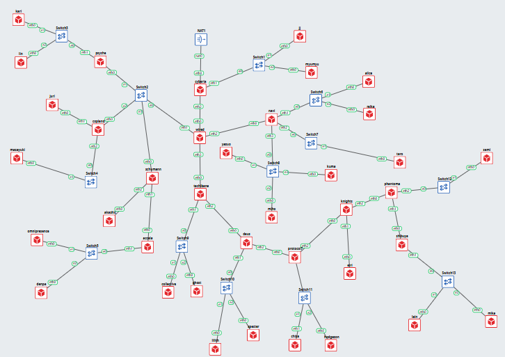

### Penjelasan Topologi:
* Jaringan **The Wired** terhubung ke internet/dunia luar secara terpusat melalui **Router Cyberia** yang tersambung ke node **NAT1**.
* Router **Wired** bertindak sebagai hub utama yang membagi jalur ke beberapa cabang besar:
  1. **Cabang Utama 1 (Kiri):** Melalui Router **Psyche**, **Copland**, dan **Schumann**. Node **Kari** berada pada Subnet Switch3 di bawah hirarki Router Psyche.
  2. **Cabang Utama 2 (Kanan):** Melalui Router **Navi** menuju entitas seperti Alice, Reika, Kuma, Yaeyo, Miho, dll.
  3. **Cabang Utama 3 (Bawah):** Melalui Router **Tachibana** yang bercabang ke Deus, Protocol7, Knights, Phantoma, hingga kawasan Shibuya (Lain & Mika).
* Seluruh alamat IP dikelompokkan dan dihitung secara hierarkis menggunakan **CIDR** untuk memastikan tidak ada alokasi IP yang terbuang (*efficient IP allocation*) serta tabel routing terkonfigurasi dengan efisien tanpa ada node yang terisolasi.

---

## 2. Inisialisasi & Pengujian Subnet Lokal Kari - Lin (`Kari-lin.png`)

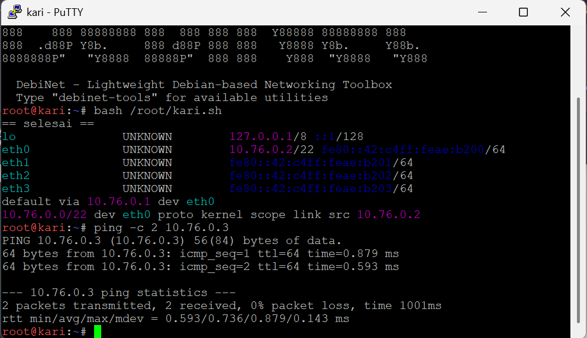

### Alur & Analisis:
1. **Inisialisasi Node:** Script `/root/kari.sh` dijalankan pada node **Kari** untuk menerapkan konfigurasi IP address dan tabel routing otomatis.
2. **Pengecekan Alokasi IP (CIDR):** 
   * Interface `eth0` mendapatkan IP `10.76.0.2/22` (Subnet Mask `255.255.252.0`). 
   * Blok CIDR `/22` ini memuat subnet lokal tempat **Kari** dan **Lin** berada.
3. **Pengecekan Gateway & Routing:** 
   * Memiliki default gateway ke `10.76.0.1 dev eth0` serta rute *directly connected* untuk subnet `10.76.0.0/22`.
4. **Pengujian Ping (`Kari -> Lin`):**
   * Command: `ping -c 2 10.76.0.3`
   * Target **Lin** berada pada subnet lokal yang sama (`10.76.0.3`).
   * **Hasil:** 2 paket terkirim dan diterima (0% packet loss), dengan `ttl=64` (default Linux TTL untuk satu segmen jaringan lokal tanpa melewati router/hop tambahan).

---

## 3. Pengujian Lintas Subnet: Kari ke Juri (`kari-juri.png`)

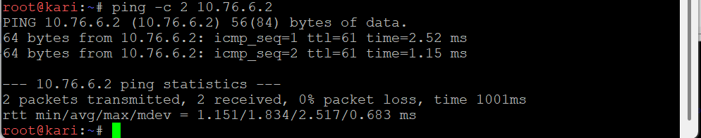

### Alur Perjalanan Paket (Routing Path):
`Kari (eth0)` $\rightarrow$ `Switch3` $\rightarrow$ `Psyche` $\rightarrow$ `Switch2` $\rightarrow$ `Copland` $\rightarrow$ `Switch4` $\rightarrow$ `Juri (10.76.6.2)`

### Analisis Hasil:
* **Command:** `ping -c 2 10.76.6.2`
* **Hasil:** 0% packet loss, RTT rata-rata `1.834 ms`.
* **Analisis TTL:** Nilai `ttl=61` berkurang dari 64 karena paket data melompati 3 *router* perantara (`Psyche` $\rightarrow$ `Switch2` $\rightarrow$ `Copland`), membuktikan rute antarnode pada segmen Copland terhubung dengan benar.

---

## 4. Pengujian Lintas Subnet: Kari ke Akashic (`kari-akashic.png`)

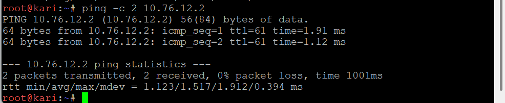

### Alur Perjalanan Paket (Routing Path):
`Kari (eth0)` $\rightarrow$ `Switch3` $\rightarrow$ `Psyche` $\rightarrow$ `Switch2` $\rightarrow$ `Schumann` $\rightarrow$ `Akashic (10.76.12.2)`

### Analisis Hasil:
* **Command:** `ping -c 2 10.76.12.2`
* **Hasil:** 0% packet loss, RTT rata-rata `1.517 ms`.
* **Analisis TTL:** Nilai `ttl=61` menunjukkan paket berhasil melewati router perantara di cabang Schumann tanpa hambatan routing.

---

## 5. Pengujian Lintas Subnet: Kari ke Denpa (`kari-denpa.png`)

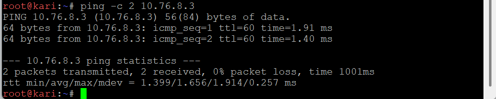

### Alur Perjalanan Paket (Routing Path):
`Kari (eth0)` $\rightarrow$ `Switch3` $\rightarrow$ `Psyche` $\rightarrow$ `Switch2` $\rightarrow$ `Schumann` $\rightarrow$ `Accela` $\rightarrow$ `Switch5` $\rightarrow$ `Denpa (10.76.8.3)`

### Analisis Hasil:
* **Command:** `ping -c 2 10.76.8.3`
* **Hasil:** 0% packet loss, RTT rata-rata `1.656 ms`.
* **Analisis TTL:** Nilai `ttl=60` berkurang 4 hop dari standar awal (64), menandakan paket melewati hirarki router yang lebih dalam (`Psyche` $\rightarrow$ `Switch2` $\rightarrow$ `Schumann` $\rightarrow$ `Accela`) hingga mencapai segmen Switch5.

---

## 6. Pengujian Lintas Subnet: Kari ke Ghost (`kari-ghost.png`)

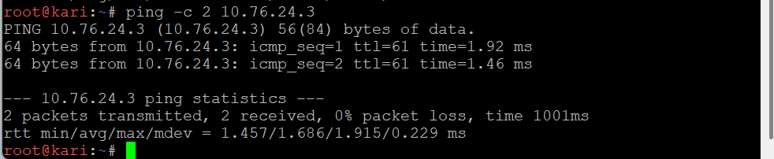

### Alur Perjalanan Paket (Routing Path):
`Kari (eth0)` $\rightarrow$ `Switch3` $\rightarrow$ `Psyche` $\rightarrow$ `Switch2` $\rightarrow$ `Wired` $\rightarrow$ `Tachibana` $\rightarrow$ `Switch9` $\rightarrow$ `Ghost (10.76.24.3)`

### Analisis Hasil:
* **Command:** `ping -c 2 10.76.24.3`
* **Hasil:** 0% packet loss, RTT rata-rata `1.686 ms`.
* **Analisis TTL:** Nilai `ttl=61` membuktikan paket sukses melintasi core router jaringan **Wired** dan berpindah dari segmen Psyche menuju segmen Tachibana/Switch9.

---

## 7. Pengujian Lapisan Dalam: Kari ke Semi (`kari-semi.png`)

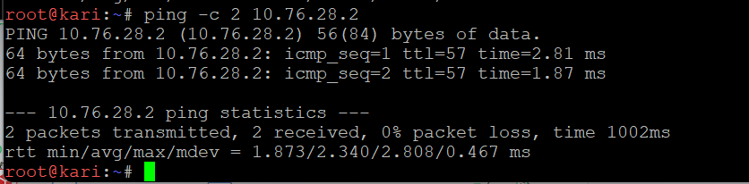

### Alur Perjalanan Paket (Routing Path):
`Kari` $\rightarrow$ `Psyche` $\rightarrow$ `Wired` $\rightarrow$ `Tachibana` $\rightarrow$ `Deus` $\rightarrow$ `Protocol7` $\rightarrow$ `Knights` $\rightarrow$ `Phantoma` $\rightarrow$ `Switch12` $\rightarrow$ `Semi (10.76.28.2)`

### Analisis Hasil:
* **Command:** `ping -c 2 10.76.28.2`
* **Hasil:** 0% packet loss, RTT rata-rata `2.340 ms`.
* **Analisis TTL:** Nilai `ttl=57` adalah yang paling kecil dibanding pengujian lainnya. Ini dikarenakan node **Semi** terletak sangat jauh di lapisan terdalam topologi *The Wired*. Paket harus melompati 7 router (`Psyche` $\rightarrow$ `Wired` $\rightarrow$ `Tachibana` $\rightarrow$ `Deus` $\rightarrow$ `Protocol7` $\rightarrow$ `Knights` $\rightarrow$ `Phantoma`), sehingga TTL berkurang dari 64 menjadi 57 ($64 - 7 = 57$).

---

## 8. Pengujian Cabang Navi: Kari ke Alice (`kari-alice.png`)

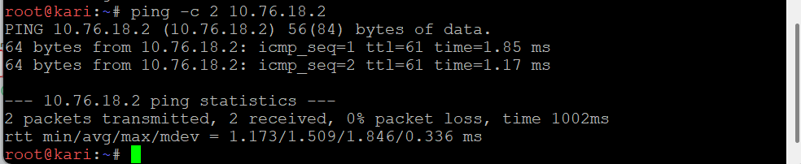

### Alur Perjalanan Paket (Routing Path):
`Kari (eth0)` $\rightarrow$ `Switch3` $\rightarrow$ `Psyche` $\rightarrow$ `Switch2` $\rightarrow$ `Wired` $\rightarrow$ `Navi` $\rightarrow$ `Switch6` $\rightarrow$ `Alice (10.76.18.2)`

### Analisis Hasil:
* **Command:** `ping -c 2 10.76.18.2`
* **Hasil:** 0% packet loss, RTT rata-rata `1.509 ms`.
* **Analisis TTL:** Nilai `ttl=61` membuktikan bahwa keterhubungan antara cabang kiri (Psyche) dan cabang kanan (Navi) melalui router hub **Wired** telah ter-routing secara optimal.

---

## Kesimpulan Pembuktian
Berdasarkan seluruh hasil pengujian *ping* dari node **Kari**:
1. **Konektivitas 100%:** Seluruh paket uji (ICMP) mencapai target tanpa *packet loss* (0% loss) baik pada subnet lokal maupun antar-subnet beda cabang.
2. **Routing Efisien:** Nilai TTL yang berkurang secara konsisten sesuai dengan jumlah hop router yang dilewati membuktikan tidak adanya *routing loop* dan tabel routing statis/CIDR telah dikonfigurasi dengan tepat.
3. **Persyaratan Modul Terpenuhi:** Seluruh node dalam topologi terhubung penuh (*full reachability*) sesuai aturan praktikum.

# Dokumentasi Perhitungan Subnetting CIDR & VLSM (The Wired - Modul 4)

Dokumen ini memuat rincian kalkulasi pembagian IP address (VLSM), pengalokasian host & interface router, serta tahap penggabungan subnet secara hirarkis (Supernetting CIDR Level I–VIII) untuk topologi jaringan **The Wired**.

---

## 1. Pendahuluan & Prinsip Dasar Perhitungan

Sesuai dengan ketentuan praktikum:
1. **Perhitungan IP per Subnet:** 
   $$\text{Jumlah IP Dibutuhkan} = \text{Jumlah Host} + \text{Jumlah Interface Router pada Subnet Tersebut}$$
2. **Penentuan Prefix/Netmask (VLSM):** Mencari pangkat dua terkecil ($2^n$) yang dapat menampung total IP yang dibutuhkan, dengan rentang usable host: $(2^n - 2)$.
3. **Prefix Utama Jaringan:** `10.76.0.0/19` (Kapasitas Total 8.192 IP, Netmask `255.255.224.0`).

---

## 2. Tabel Alokasi IP & Subnetting CIDR (`Pembagian IP - CIDR`)

Setiap subnet dihitung berdasarkan urutan kebutuhan terbesar ke terpencil untuk efisiensi ruang pengalamatan:

| Sayap | Subnet | Kebutuhan Host / Detail Entitas | CIDR | Network ID | Broadcast | Usable Range IP |
| :--- | :--- | :--- | :---: | :--- | :--- | :--- |
| **Kiri** | **A4** | Karl, Lin ($700 + 180 = 880$ host $+ 1$ router) | `/22` | `10.76.0.0` | `10.76.3.255` | `10.76.0.1 - 10.76.3.254` |
| | **A5** | Masayuki ($300$ host $+ 1$ router) | `/23` | `10.76.4.0` | `10.76.5.255` | `10.76.4.1 - 10.76.5.254` |
| | **A6** | Juri ($31$ host $+ 1$ router) | `/26` | `10.76.6.0` | `10.76.6.63` | `10.76.6.1 - 10.76.6.62` |
| | **A9** | Omnipresence, Denpa ($219 + 5 host + 1$ router) | `/22` | `10.76.8.0` | `10.76.11.255` | `10.76.8.1 - 10.76.11.254` |
| | **A7** | Schumann > Akashic ($3$ host $+ 1$ router) | `/29` | `10.76.12.0` | `10.76.12.7` | `10.76.12.1 - 10.76.12.6` |
| | **A8** | Schumann > Accela ($2$ interface router) | `/30` | `10.76.12.8` | `10.76.12.11` | `10.76.12.9 - 10.76.12.10` |
| **Kanan** | **A13** | Yasuo, Miho, Kuma ($128 + 10 + 4 = 142$ host $+ 1$ router) | `/24` | `10.76.16.0` | `10.76.16.255` | `10.76.16.1 - 10.76.16.254` |
| | **A12** | Navi > Switch3 > Taro ($57$ host $+ 1$ router) | `/26` | `10.76.17.0` | `10.76.17.63` | `10.76.17.1 - 10.76.17.62` |
| | **A11** | Alice, Reika ($700 + 200 \rightarrow$ penyesuaian $254$ IP) | `/24` | `10.76.18.0` | `10.76.18.255` | `10.76.18.1 - 10.76.18.254` |
| | **A1** | Cyberia > Switch1 > JJ, MyuMyu ($126$ host $+ 1$ router) | `/25` | `10.76.20.0` | `10.76.20.127` | `10.76.20.1 - 10.76.20.126` |
| | **B6** | Cyberia/Wired/Navi PTP Inter-router | `/29` | `10.76.20.128` | `10.76.20.135` | `10.76.20.129 - 10.76.20.134` |
| | **A3** | Wired > Switch2 Inter-router | `/29` | `10.76.20.136` | `10.76.20.143` | `10.76.20.137 - 10.76.20.142` |
| | **A2** | Cyberia > Wired Inter-router | `/30` | `10.76.20.144` | `10.76.20.147` | `10.76.20.145 - 10.76.20.146` |
| **Bawah** | **A15** | Tachibana > Switch9 > Collective, Ghost ($260$ host $+ 1$ router) | `/23` | `10.76.24.0` | `10.76.25.255` | `10.76.24.1 - 10.76.25.254` |
| | **A16** | Tachibana > Deus ($2$ interface router) | `/30` | `10.76.26.0` | `10.76.26.3` | `10.76.26.1 - 10.76.26.2` |
| | **A23** | Phantoma > Switch12 > Semi ($14$ host $+ 1$ router) | `/27` | `10.76.28.0` | `10.76.28.31` | `10.76.28.1 - 10.76.28.30` |
| | **A24** | Phantoma > Shibuya ($2$ interface router) | `/30` | `10.76.28.32` | `10.76.28.35` | `10.76.28.33 - 10.76.28.34` |
| | **A25** | Shibuya > Switch13 > Lain, Mika ($57 + 4$ host $+ 1$ router) | `/26` | `10.76.28.64` | `10.76.28.127` | `10.76.28.65 - 10.76.28.126` |
| | **A21** | Knights > Eiri ($2$ host $+ 1$ router) | `/29` | `10.76.28.128` | `10.76.28.135` | `10.76.28.129 - 10.76.28.134` |
| | **A22** | Knights > Phantoma ($2$ interface router) | `/30` | `10.76.28.136` | `10.76.28.139` | `10.76.28.137 - 10.76.28.138` |
| | **A19** | Protocol7 > Switch11 > Chisa, Hodgeson ($23 + 9$ host $+ 1$ router) | `/26` | `10.76.29.0` | `10.76.29.63` | `10.76.29.1 - 10.76.29.62` |
| | **A20** | Protocol7 > Knights ($2$ interface router) | `/30` | `10.76.29.64` | `10.76.29.67` | `10.76.29.65 - 10.76.29.66` |
| | **A17** | Deus > Switch10 > Lilith, Specter ($77 + 21$ host $+ 1$ router) | `/25` | `10.76.30.0` | `10.76.30.127` | `10.76.30.1 - 10.76.30.126` |
| | **A18** | Deus > Protocol7 ($2$ interface router) | `/30` | `10.76.30.128` | `10.76.30.131` | `10.76.30.129 - 10.76.30.130` |

---

## 3. Tahap Penggabungan CIDR Berjenjang (Level I – VIII)

Proses **CIDR Aggregation (Route Summarization)** dilakukan secara bertahap dari daun pohon topologi (*leaf nodes*) menuju router pusat **Wired/Cyberia**:

### Level I: Penggabungan Subnet Terluar (`level_1_I.png`)
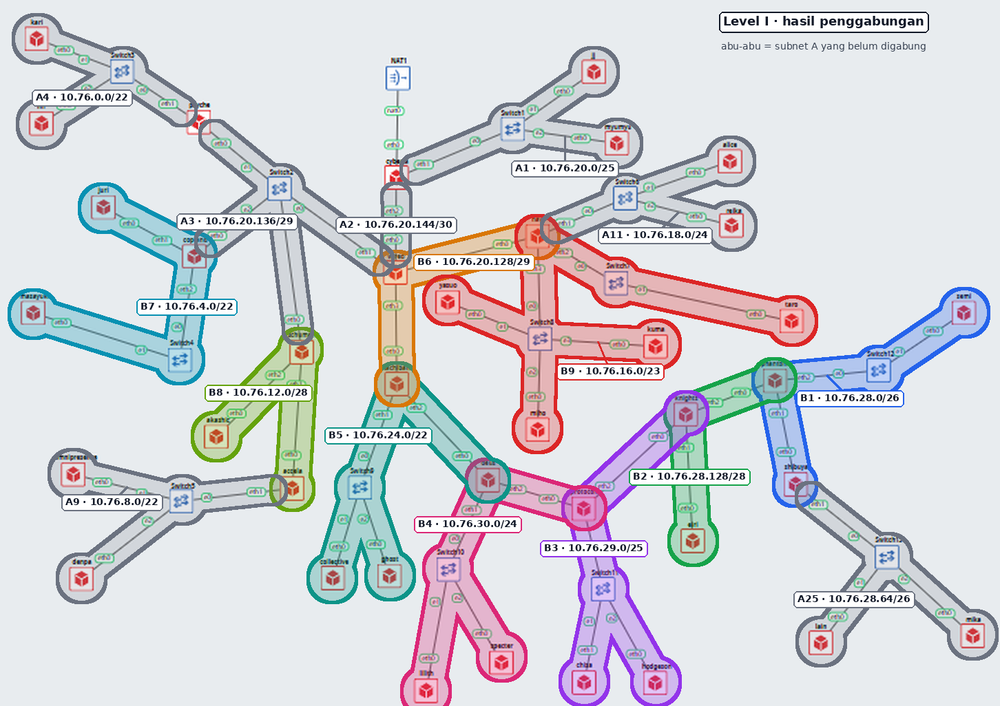

Menggabungkan subnet point-to-point kecil dan subnet daun terdekat:
* **B1** (`/26`): Gabungan `A23 (/27)` + `A24 (/30)` $\rightarrow$ `10.76.28.0/26`
* **B2** (`/28`): Gabungan `A21 (/29)` + `A22 (/30)` $\rightarrow$ `10.76.28.128/28`
* **B3** (`/25`): Gabungan `A19 (/26)` + `A20 (/30)` $\rightarrow$ `10.76.29.0/25`
* **B4** (`/24`): Gabungan `A17 (/25)` + `A18 (/30)` $\rightarrow$ `10.76.30.0/24`
* **B5** (`/22`): Gabungan `A15 (/23)` + `A16 (/30)` $\rightarrow$ `10.76.24.0/22`
* **B6** (`/29`): Gabungan Inter-router `A10 (/30)` + `A14 (/30)` $\rightarrow$ `10.76.20.128/29`
* **B7** (`/22`): Gabungan `A5 (/23)` + `A6 (/26)` $\rightarrow$ `10.76.4.0/22`
* **B8** (`/28`): Gabungan `A7 (/29)` + `A8 (/30)` $\rightarrow$ `10.76.12.0/28`
* **B9** (`/23`): Gabungan `A13 (/24)` + `A12 (/26)` $\rightarrow$ `10.76.16.0/23`

---

### Level II: Aggregation Cabang Utama (`level_2_II.png`)
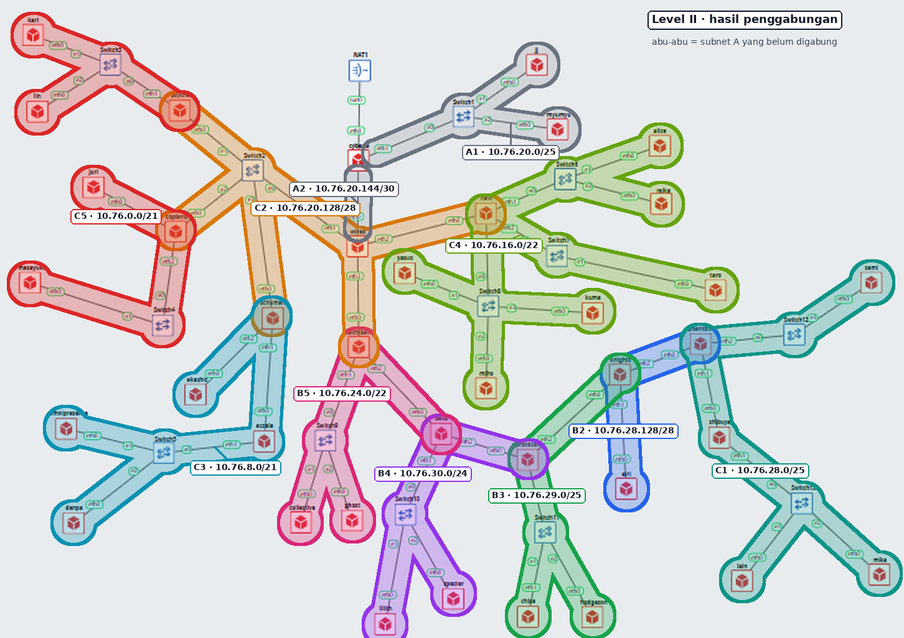

* **C1** (`/25`): Gabungan `B1 (/26)` + `A25 (/26)` (Kawasan Shibuya & Phantoma) $\rightarrow$ `10.76.28.0/25`
* **C2** (`/28`): Gabungan `B6 (/29)` + `A3 (/29)` (Jalur Core Inter-router) $\rightarrow$ `10.76.20.128/28`
* **C3** (`/21`): Gabungan `A9 (/22)` + `B8 (/28)` (Cabang Schumann/Accela) $\rightarrow$ `10.76.8.0/21`
* **C4** (`/22`): Gabungan `B9 (/23)` + `A11 (/24)` (Cabang Navi Utama) $\rightarrow$ `10.76.16.0/22`
* **C5** (`/21`): Gabungan `A4 (/22)` + `B7 (/22)` (Cabang Psyche & Copland) $\rightarrow$ `10.76.0.0/21`

---

### Level III: Summarization Wilayah Barat & Timur (`level_3_III.png`)
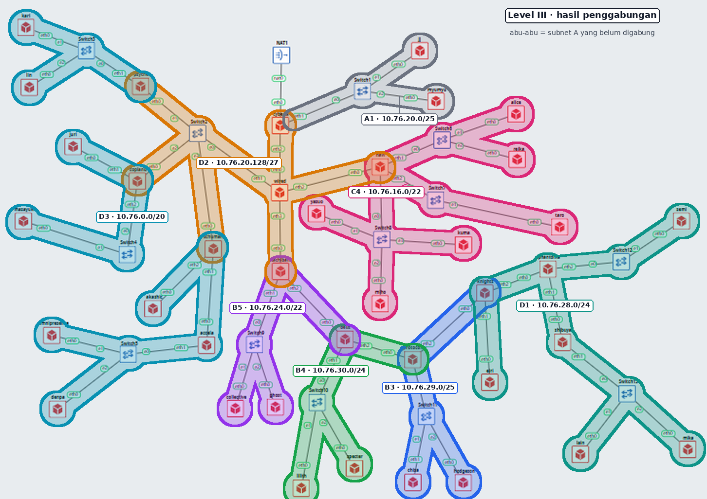

* **D1** (`/24`): Gabungan `C1 (/25)` + `B2 (/28)` (Kawasan Knights & Phantoma) $\rightarrow$ `10.76.28.0/24`
* **D2** (`/27`): Gabungan `C2 (/28)` + `A2 (/30)` (Jalur Cyberia-Wired) $\rightarrow$ `10.76.20.128/27`
* **D3** (`/20`): Gabungan `C5 (/21)` + `C3 (/21)` (Seluruh Sayap Kiri: Psyche, Copland, Schumann) $\rightarrow$ `10.76.0.0/20`

---

### Level IV: Consolidation Cabang Protocol & Cyberia (`level_4_IV.png`)
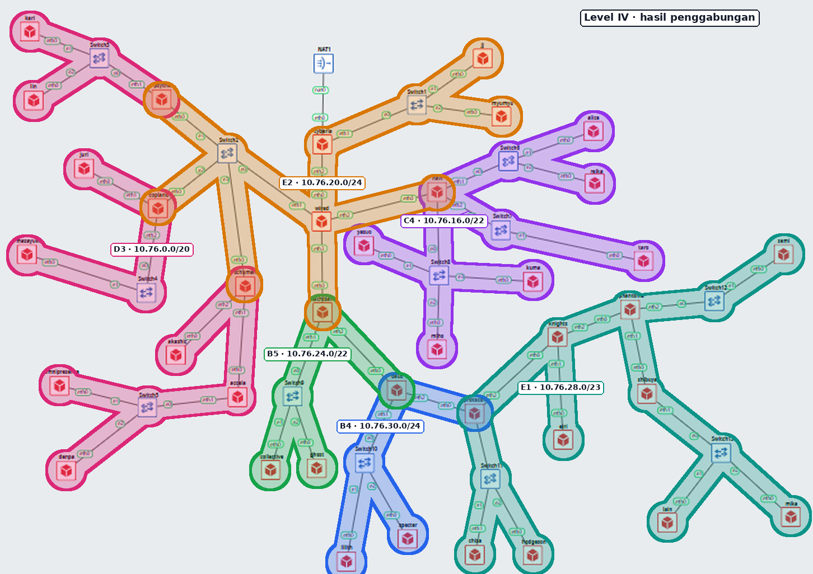

* **E1** (`/23`): Gabungan `D1 (/24)` + `B3 (/25)` (Wilayah Protocol7 & Knights) $\rightarrow$ `10.76.28.0/23`
* **E2** (`/24`): Gabungan `A1 (/25)` + `D2 (/27)` (Kawasan Cyberia & Gateway Utama) $\rightarrow$ `10.76.20.0/24`

---

### Level V: Consolidation Deus & Core Navi (`level_5_V.png`)
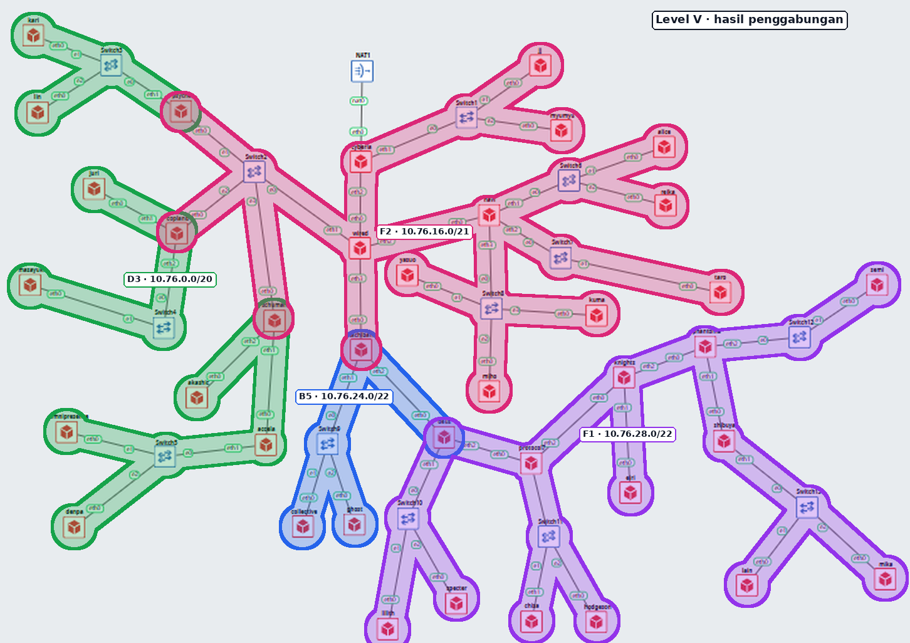

* **F1** (`/22`): Gabungan `E1 (/23)` + `B4 (/24)` (Seluruh Sektor Deus & Protocol7) $\rightarrow$ `10.76.28.0/22`
* **F2** (`/21`): Gabungan `C4 (/22)` + `E2 (/24)` (Seluruh Cabang Atas & Navi) $\rightarrow$ `10.76.16.0/21`

---

### Level VI: Aggregate Sektor Tachibana Bawah (`level_6_VI.png`)
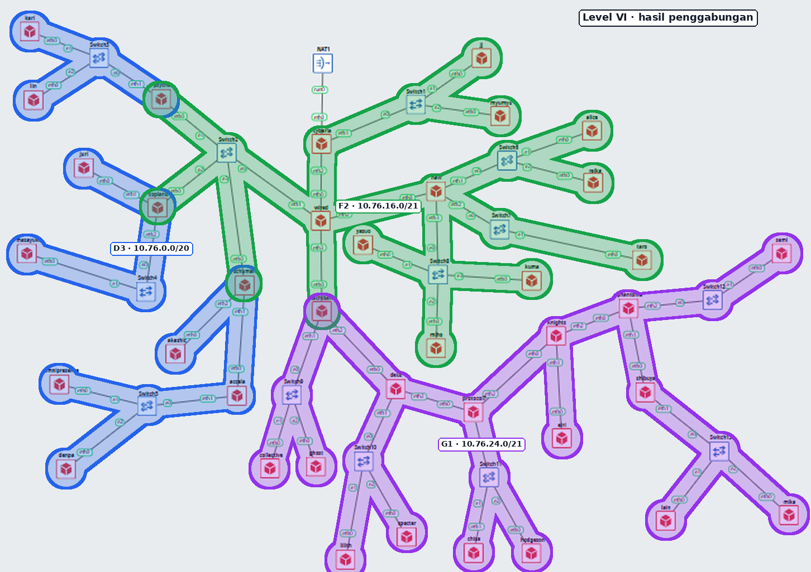

* **G1** (`/21`): Gabungan `B5 (/22)` + `F1 (/22)` (Seluruh Kawasan Bawah Tachibana) $\rightarrow$ `10.76.24.0/21`

---

### Level VII: Merging Seluruh Sayap Kanan & Bawah (`level_7_VII.png`)
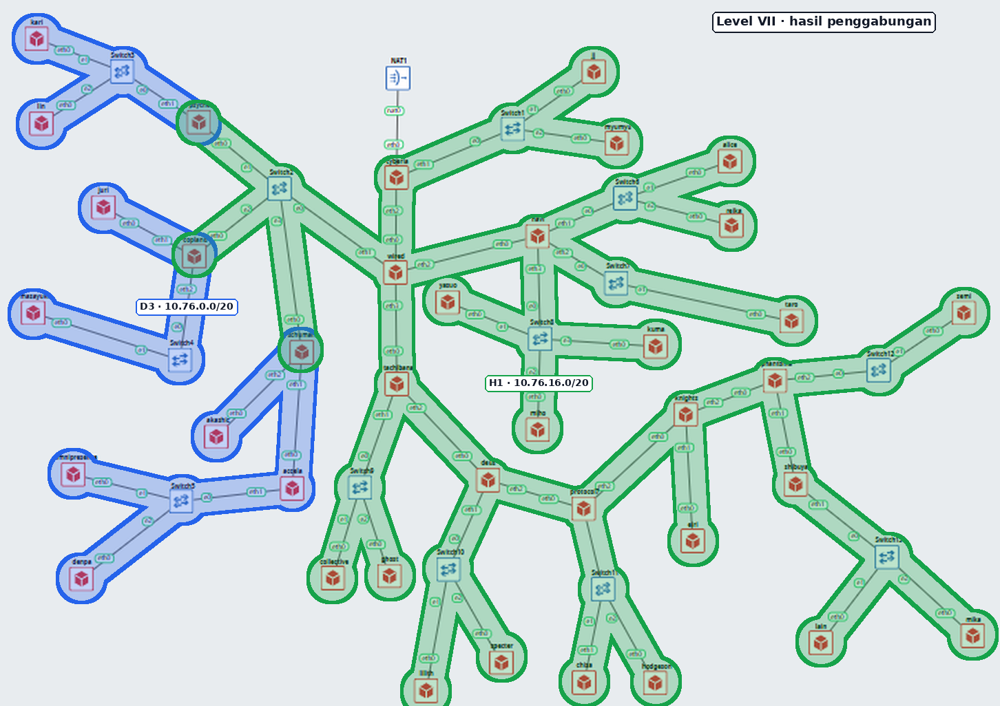

* **H1** (`/20`): Gabungan `F2 (/21)` + `G1 (/21)` (Seluruh Kawasan Timur & Selatan The Wired) $\rightarrow$ `10.76.16.0/20`

---

### Level VIII: Root Summarization Total (`level_8_VIII.png`)
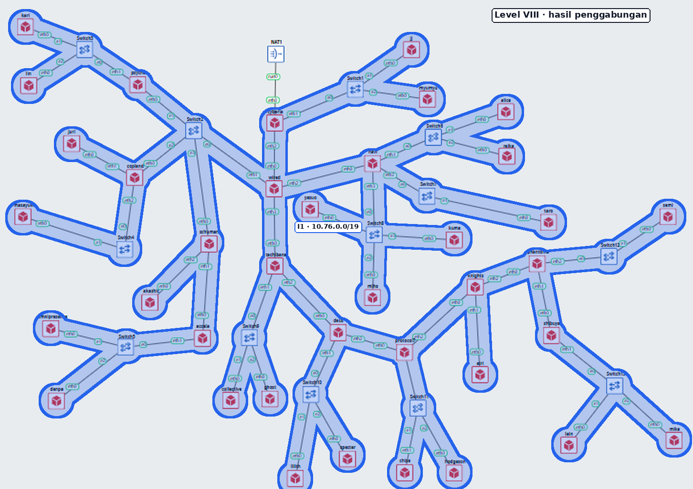

* **I1** (`/19`): Gabungan `D3 (/20)` (Sayap Kiri) + `H1 (/20)` (Sayap Kanan & Bawah) $\rightarrow$ **`10.76.0.0/19`**

---

## 4. Kesimpulan Hasil Akhir

1. **Hasil Akhir Supernetting (`I1`):** `10.76.0.0/19` melingkupi seluruh 25 subnet dari `A1` hingga `A25` tanpa ada blok IP yang terputus atau tumpang tindih (*zero IP space collision*).
2. **Efisiensi Routing Table:** Dengan hirarki supernetting hingga 8 level ini, router utama **Wired** dan **Cyberia** hanya memerlukan tabel routing ringkas berbasis supernet untuk meneruskan paket data ke seluruh cabang topologi *The Wired*.
